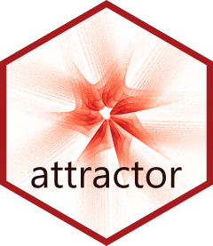

<!-- README.md is generated from README.Rmd. Please edit that file -->

```{r, include = FALSE}
knitr::opts_chunk$set(
  collapse = TRUE,
  comment = "#>",
  fig.path = "man/figures/README-",
  out.height = "400px"
)
knitr::opts_knit$set(global.par = TRUE)
par(mar = rep(0, 4), mai = rep(0, 4))
```

# attractor 


<!-- badges: start -->
[](https://cran.r-project.org/package=attractor)
[](https://codecov.io/gh/andrie/attractor?branch=master)
<!-- badges: end -->

The goal of `attractor` is to generate and plot strange attractors.

Julien C. Sprott's book *Strange Attractors: Creating Patterns in Chaos* (1993) shows how to make an endless variety of fractal patterns from simple equations. You don't pick the coefficients yourself. The computer picks them at random, iterates the equations, and keeps the result only if the orbit settles into something worth looking at. The book describes over 350 such patterns, in two, three and more dimensions, and it is still a good read if you like maths, art, or both.

This package implements only the example in chapter 7e. Give it a seed and it finds the coefficients for that seed, so the same seed always gives you the same picture. Then it iterates the map for as many points as you ask for.

Since the computation (both the orbit and the discretization) is done in Rust, it is very fast. It takes a fraction of a second to generate an oribt with a millions of points, and it's feasible to generate orbits of billions of points.  The resulting plot is a matrix of only a few hundred pixels in each dimension, so it is also very fast to plot.

The book is available as a free PDF from [Sprott's website](https://sprott.physics.wisc.edu/fractals.htm).


## Installation

You can install the development version from [GitHub](https://github.com/) with:

``` r
# install.packages("devtools")
devtools::install_github("andrie/attractor")
```

## Example

Create a strange attractor with 10 million points, then discretize to a matrix with dimensions `400 x 400`:


```{r}
library(attractor)
dat <-
  seed_sprott_7e(21031) |>
  attractor_sprott_7e(1e6, dims = c(400, 400))

dat |>
  plot()
```


## Plotting a strange attractor

```{r}
par(mar = rep(0, 4), mai = rep(0, 4))
dat |>
  recolour() |>
  plot()
```


## Recolour the plot

Use `recolour()` to change the colours. You can use any of the colours defined by the `scales::col_numeric()` function. From the help of `?scales::col_numeric()`:

The palette argument can be any of the following:

1. A character vector of RGB or named colours. Examples: `palette()`, `c("#000000", "#0000FF", "#FFFFFF")`, `topo.colors(10)`

2. The name of an `RColorBrewer` palette, e.g. `"BuPu"` or `"Greens"`.

3. A function that receives a single value between 0 and 1 and returns a colour. Examples: `colorRamp(c("#000000", "#FFFFFF"), interpolate="spline")`.


Use the `Oranges` palette:

```{r}
dat |>
  recolour("Oranges") |>
  plot()
```

To change the background colour, specify a `zero_colour`:

```{r}
dat |>
  recolour("Oranges", zero_colour = "#FFFAF6") |>
  plot()
```

You can also invert the palette

```{r}
dat |>
  recolour("Oranges", zero_colour = "grey20", invert = TRUE) |>
  plot()
```

Try the `Spectral` palette:


```{r}
dat |>
  recolour("Spectral", zero_colour = "#9E0142") |>
  plot()
```

With inversion:

```{r}
dat |>
  recolour("Spectral", invert = TRUE, zero_colour = "#5E4FA2") |>
  plot()
```


