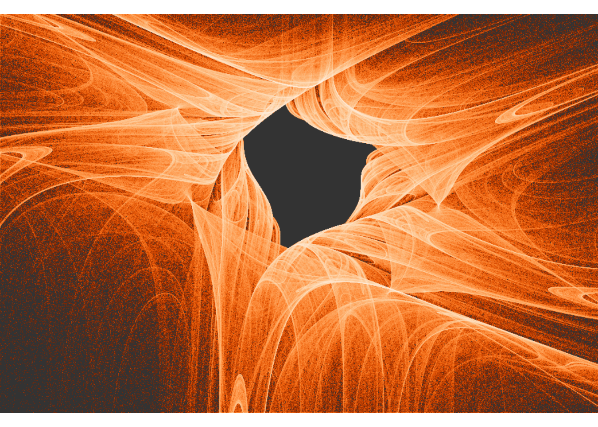

# Introduction to attractor

``` r

library(attractor)
```

``` r

# Generate points, trim at the 0.03 quantile, and discretize to a 600x900 matrix
# Generate the seed vector (14 random values)
# Plot using various palettes from `RColorBrewer`
seed_sprott_7e(fast_forward = 429) |>
  attractor_sprott_7e(n = 1e7, qs = 0.03, dims = c(600, 900)) |>
  plot(palette = "Oranges", zero_colour = "grey20", invert = TRUE)
```


